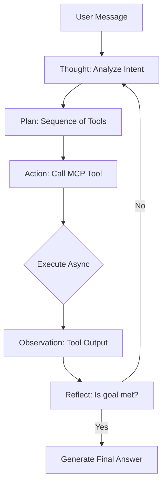

# ASURA Technical Architecture

**ASURA (Autonomous Sovereign Reasoning Agent)** is a high-autonomy, locally-governed AI ecosystem. This document serves as the master technical specification for the system's core engine, safety protocols, and evolutionary logic.

---

## 1. Core Philosophy: Agentic Sovereignty

ASURA is built on five non-negotiable technical pillars:

1.  **Local Sovereignty**: All reasoning, semantic memory (FAISS), and logic remain on hardware owned by the Master. No third-party cloud dependency for core intelligence.
2.  **Asynchronous Resilience**: A non-blocking architecture using `AsyncGateway` and **Parallel-Turbo** preparation to handle parallel inputs from TUI, Web, and Telegram with zero latency.
3.  **Tiered Intelligence**: Dynamic model routing using a "Draft-and-Verify" pattern (0.8B Fast Model for routing, **GPT-OSS 20B** Heavy Model for reasoning).
4.  **Structural Self-Awareness**: A live, incremental AST-scanned Knowledge Graph that allows the AI to understand its own codebase in near-real-time.
5.  **Persistent Sovereignty**: Automatic cross-platform wake-locking (**Sovereign Power Lock**) to ensure cluster nodes (Mac/Windows) remain responsive.

---

## 2. The Engine: Tiered ReAct Loop

ASURA operates via an iterative **ReAct (Reason + Act)** loop, implemented in `src/core/reasoning.py`.

### Two-Tier Model Routing
- **Fast Tier (0.8B)**: Handles intent classification, JSON schema extraction, and simple queries.
- **Heavy Tier (GPT-OSS 20B)**: Handles complex multi-step planning, coding, and architectural debugging.

### The Reasoning Protocol (ASURA-Zero)

1.  **Thought**: Analyze user intent and inventory available tools (via AST signatures).
2.  **Plan**: Construct a sequence of tool calls.
3.  **Act**: Execute tools via the MCP-Lite `tool_protocol.py`.
4.  **Observe**: Capture tool output (STDOUT, File data, etc.) with automatic context truncation to prevent window explosion.
5.  **Reflect**: Use the Heavy model to evaluate if the objective was met.

---

## 3. Sovereign Core: Module Reference

| Module | Purpose | File |
|:---|:---|:---|
| **anesthesia** | Unknown | `src/core/anesthesia.py` |
| **antigravity_bridge** | Antigravity Agent & IDE Bridge | `src/core/antigravity_bridge.py` |
| **ast_surgeon** | Unknown | `src/core/ast_surgeon.py` |
| **auth** | Unknown | `src/core/auth.py` |
| **brain_router** | Dynamic Brain Router & Failover Engine | `src/core/brain_router.py` |
| **consciousness** | Autonomous Consciousness & Metacognition | `src/core/consciousness.py` |
| **context_manager** | Context Window Management | `src/core/context_manager.py` |
| **curiosity** | Unknown | `src/core/curiosity.py` |
| **declarative_agent_loader** | Declarative Agent System | `src/core/declarative_agent_loader.py` |
| **doc_updater** | Autonomous Documentation Daemon | `src/core/doc_updater.py` |
| **federation** | Peer-to-Peer AI Synchronization | `src/core/federation.py` |
| **formatter** |  | `src/core/formatter.py` |
| **gateway** | Interactive Gateway | `src/core/gateway.py` |
| **habits** | AI Idle Habits | `src/core/habits.py` |
| **handoff** | Autonomous Agent Handoff Protocol | `src/core/handoff.py` |
| **hooks** | Pre/Post Tool Execution Hooks | `src/core/hooks.py` |
| **interceptors** | Security & Safety Interceptor System | `src/core/interceptors.py` |
| **job_manager** | Async Background Job Execution | `src/core/job_manager.py` |
| **knowledge_graph** | Unknown | `src/core/knowledge_graph.py` |
| **knowledge_scanner** | Unknown | `src/core/knowledge_scanner.py` |
| **llm** | Unknown | `src/core/llm.py` |
| **mcp** | Full Model Context Protocol (JSON-RPC 2.0) | `src/core/mcp.py` |
| **memory_manager** | Unknown | `src/core/memory_manager.py` |
| **model_manager** | Model Capability Registry & Router | `src/core/model_manager.py` |
| **observability** | Tool Execution Observability | `src/core/observability.py` |
| **observer** | Proactive File System Observer | `src/core/observer.py` |
| **permissions** | Granular Permissions Framework | `src/core/permissions.py` |
| **phantom_verify** | Ghost Sandbox Verification | `src/core/phantom_verify.py` |
| **proactive** | Proactive Messaging & Idle Behavior | `src/core/proactive.py` |
| **rbac** | Role-Based Access Control | `src/core/rbac.py` |
| **reasoning** | Chain-of-Thought Reasoning Engine | `src/core/reasoning.py` |
| **recommendation** | Unified Recommendation & Task Store | `src/core/recommendation.py` |
| **resource_governor** | Resource Governor | `src/core/resource_governor.py` |
| **rule_engine** | Declarative Behavior Rule Engine | `src/core/rule_engine.py` |
| **self_healing** | Autonomous Self-Healing Daemon | `src/core/self_healing.py` |
| **self_recovery** | Deep Recursive Self-Repair | `src/core/self_recovery.py` |
| **self_updater** | LLM-Driven Self-Evolution Engine | `src/core/self_updater.py` |
| **sovereignty** | Cross-Platform Anti-Sleep Protocol | `src/core/sovereignty.py` |
| **startup_checks** | Boot-time tool verification | `src/core/startup_checks.py` |
| **state_manager** | Unknown | `src/core/state_manager.py` |
| **sub_agent_memory** | Unknown | `src/core/sub_agent_memory.py` |
| **surgeon** | Unknown | `src/core/surgeon.py` |
| **task_queue** | Priority Task Queue | `src/core/task_queue.py` |
| **tool_protocol** | MCP-Lite: Dynamic Tool Protocol | `src/core/tool_protocol.py` |
| **unified_memory** | Unified Sovereign Memory System | `src/core/unified_memory.py` |
| **vcs** | Unknown | `src/core/vcs.py` |
| **workflow_engine** | YAML-Driven Workflow Automation | `src/core/workflow_engine.py` |
---

## 4. Multi-Layer Sovereign Memory

ASURA solves "Context Starvation" via a tiered storage architecture:

*   **Level 1 (Working Memory)**: Rolling context window managed in `context_manager.py`.
*   **Level 2 (Episodic & Semantic RAG)**: Unified sovereign memory store (`src/core/unified_memory.py`) and FAISS vector embeddings (`nomic-embed-text`).
*   **Level 3 (Relational Knowledge Graph)**: Architectural Knowledge Graph (`src/core/knowledge_graph.py`) mapping functions, classes, and call graphs via AST.
*   **Level 4 (Sovereign Vault)**: Persistent master rules, identity, and preferences in `data/memory/sovereign_memory.json`.
*   **Level 5 (Sub-Agent Vaults)**: Isolated JSON scratchpads for declarative sub-agents (`src/core/sub_agent_memory.py`).

---

## 5. Sandboxing & Testing Architecture

ASURA uses a multi-tiered isolation strategy depending on risk profile:

### A. Host-Level Safety Sandbox (`src/skills/shell_executor/executor.py`)
* Enforces `is_safe_path()` checks to prevent directory traversal outside `PROJECT_ROOT`.
* Command blocklist filters dangerous OS commands (`rm -rf /`, `mkfs`, fork bombs).
* Out-of-bounds file operations require interactive Master approval via Telegram/TUI.

### B. Minimal Run Environment (MRE) Surgical Room (`src/core/surgeon.py`)
* Clones "vital organs" of the codebase into `data/surgery/ot_<id>/`.
* Runs AST mutation and automated syntax checks in isolated subprocesses before touching production code.

### C. Headless Virtual Display & Android Sandbox (`src/skills/sandbox/container_manager.py`)
* Isolated Docker/Podman container (`asura-sandbox`) running headless X11 (`Xvfb :99`), Openbox window manager, and ADB server on port `5555`.
* Completely quarantines untrusted shell commands, arbitrary scripts, and untrusted APK/mobile automation.
* Provides virtual display screenshots and live visual streaming via noVNC (port `6080`) and VNC (port `5900`).

### D. Testing & Verification Hierarchy
1. **Pytest Test Suite (`tests/`)**: Comprehensive unit and integration test suite covering drivers, consciousness, voice, brain routing, and tools.
2. **Auto-Tester Engine (`src/skills/auto_tester/tester.py`)**:
   - `py_compile` syntax validation.
   - Subprocess import verification for every registered skill.
   - LLM-based intent verification against original task prompt.
3. **Phantom Branches (`src/core/self_updater.py`)**: Git branches created for self-evolution changes; merged into `master` only if auto-tests pass.
4. **Ghost Repair (`src/core/self_recovery.py`)**: Invertible patch rollbacks via `.tf_vcs` and Golden Snapshot restoration.

---

## 6. Dynamic Multi-Model Cascades (BrainRouter)

ASURA implements adaptive model tiering (`src/core/brain_router.py`):
1. **OpenRouter Pool**: Prioritizes state-of-the-art models (`openrouter/free` pool and flagship endpoints).
2. **Groq Cloud Tier**: Ultra-low-latency Llama-3.3-70B for real-time conversation and fast reasoning.
3. **Local Offline Tier (Ollama)**: Local models (e.g., Qwen-2.5, DeepSeek-R1) and local multimodal vision (`src/skills/visual/local_vision.py`) ensuring 100% operation when disconnected.
4. **Graceful Offline Mode**: Tasks queue during internet drops and automatically flush when connectivity resumes.

---

## 7. Witness Immune Self-Healing

Implemented in `src/core/self_healing.py`:
1. **Sentinel (Sensing)**: Pattern-agnostic log monitoring for anomaly scents.
2. **Architect-Critic (Brain)**: High-tier model plans the fix; fast model inspects for security and bloat.
3. **AST Surgeon**: Precision symbol splicing without disturbing unrelated lines or comments.
4. **Witness (Federation)**: Cross-node peer verification before pushing evolutions to shared repositories.

---

## 8. Production Directory Structure

```
ASURA/
├── src/
│   ├── core/           # Sovereign Engine (BrainRouter, Consciousness, Memory, AST Surgeon)
│   │   └── utils/      # Shared utilities (JSON, retry, time, visual tables)
│   ├── skills/         # 50+ Capabilities (Device control, Sandbox, Voice, Visual, etc.)
│   ├── cli/            # Interface: TUI, interactive CLI, and REPL
│   ├── agents/         # Personas: Markdown-defined specialists
│   └── protocols/      # Communication and protocol specifications
├── tests/              # Verification: Unit, integration, and benchmark tests
├── docker/             # Sandboxing: Dockerfile.sandbox & docker-compose.sandbox.yml
├── data/               # Persistent runtime storage (vault, memory store, logs, surgery)
└── docs/               # Sovereignty: Master Documentation
```

---
*Last Updated: October 2026 (Autonomous Sovereign Edition)*
